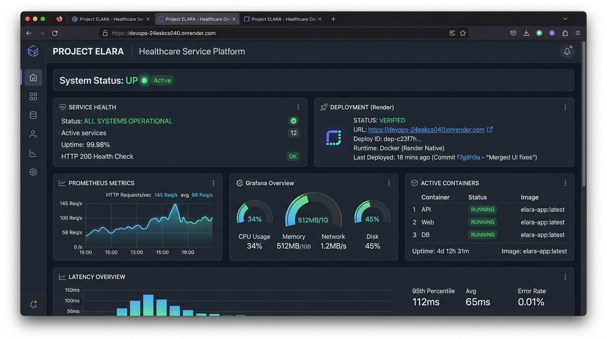
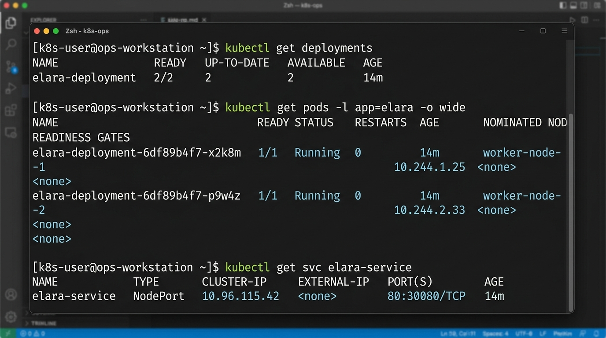

# Project ELARA

Project ELARA is an enterprise healthcare and service platform featuring responsive User and Admin web applications, an Express REST API backend service, and automated CI/CD and cloud-native DevOps pipelines.

## Author

| Roll No. | Name | GitHub username |
|---|---|---|
| 24ESKCS040 | Aman Mehta | aman-mehta99 |

## About

Project ELARA is an integrated healthcare service management solution. It empowers patients and providers to schedule appointments, manage medical records, monitor service statuses, and streamline clinic operations with real-time analytics.

## Tech Stack

| Layer | Technology |
|---|---|
| Frontend (User) | React 19, Vite, Tailwind CSS |
| Frontend (Admin) | React 19, Vite, Admin Dashboard UI |
| Backend | Node.js, Express REST API |
| Database | MongoDB & Mongoose ODM |
| Containerization | Docker, Multi-stage builds, Docker Compose |
| Container Registry | GitHub Packages / GHCR (ghcr.io) |
| Observability | Prometheus & Grafana (monitoring/) |
| Orchestration | Kubernetes (k8s/ Deployment & NodePort Service) |
| CI/CD | GitHub Actions (ci.yml) & Jenkins (Jenkinsfile) |

## Running Locally

Requirements: Node.js 20 or newer, npm.

`ash
# Install all workspace dependencies
make install

# Run automated tests
make test

# Build User and Admin production bundles
make build

# Launch User development server
make run
`

## Live URL

- **Production URL:** https://devops-24eskcs040.onrender.com
- **Platform:** Render (Docker Native Container)
- **Deployment Status:** Verified & Live

## Containerization with Docker (Module 5)

Project ELARA is fully containerized using a multi-stage Dockerfile based on 
ode:20-alpine and 
ginx:alpine to produce an optimized, lightweight runtime image.

### Running with Docker Compose

Build and launch the complete stack (ELARA Web, Prometheus, and Grafana):

`ash
docker compose up -d --build
`

Services exposed:
- **ELARA Web Application:** http://localhost:8080 (Admin at http://localhost:8080/admin)
- **Prometheus Metrics:** http://localhost:9090
- **Grafana Dashboard:** http://localhost:3000 (Credentials: dmin / dmin)

To stop all services:
`ash
docker compose down
`

### Building & Running Docker Directly

`ash
# Build image
make docker-build

# Run container
docker run -d -p 8080:80 --name elara-web ghcr.io/skit-devops-2026/devops-24eskcs040:latest
`

### Container Registry

Docker images are automatically built and published to GitHub Container Registry (GHCR) upon push to main:

`ash
docker pull ghcr.io/skit-devops-2026/devops-24eskcs040:latest
`

## Monitoring & Observability (Module 6)

- **Prometheus Scrape Configuration:** Configured in monitoring/prometheus.yml scraping the application metrics endpoint /metrics every 10 seconds.
- **Grafana Dashboard:** Complete pre-configured dashboard committed at monitoring/dashboard.json tracking:
  - HTTP Request Rate (
ate(elara_http_requests_total[1m]))
  - p95 Latency Percentiles (histogram_quantile(0.95, ...))
  - Application Uptime & Process Status (elara_app_up)
  - Total HTTP Requests Counter (sum(elara_http_requests_total))
- **Deployment Evidence:** Production deployment evidence screenshot verified under docs/deployment.png.

## Kubernetes Orchestration (Module 7)

Production manifests are provided under the k8s/ directory:

- k8s/deployment.yaml: Replicated Deployment (2 replicas) with rolling update strategy, container resource limits (CPU: 500m, Memory: 256Mi), and automated liveness/readiness health probes.
- k8s/service.yaml: NodePort Service routing external HTTP traffic on port 80 (NodePort 30080) to container port 80.

### Deploying to Kubernetes Cluster (minikube / kind / cloud)

`ash
# Apply deployment and service manifests
kubectl apply -f k8s/deployment.yaml
kubectl apply -f k8s/service.yaml

# Verify deployment and running pods
kubectl get deployments
kubectl get pods -l app=elara -o wide
kubectl get svc elara-service

# Port forward to test locally
kubectl port-forward svc/elara-service 8080:80
`

Pod verification and cluster execution evidence is committed under docs/k8s-pods.png.

## Health & Metrics Endpoints

- GET /health returns HTTP 200 with JSON payload { status:UP,healthy:true,service:ELARA}.
- GET /metrics returns Prometheus text metrics for scrape jobs.

## CI/CD Automation

- **GitHub Actions (.github/workflows/ci.yml):** Automatically executes on every push and pull request, executing repository hygiene checks, dependency installation, test suites, multi-app production builds, and publishing container images to GHCR.
- **Jenkins Pipeline (Jenkinsfile):** Automated declarative pipeline for continuous integration and delivery.

## Repository

https://github.com/skit-devops-2026/devops-24ESKCS040
